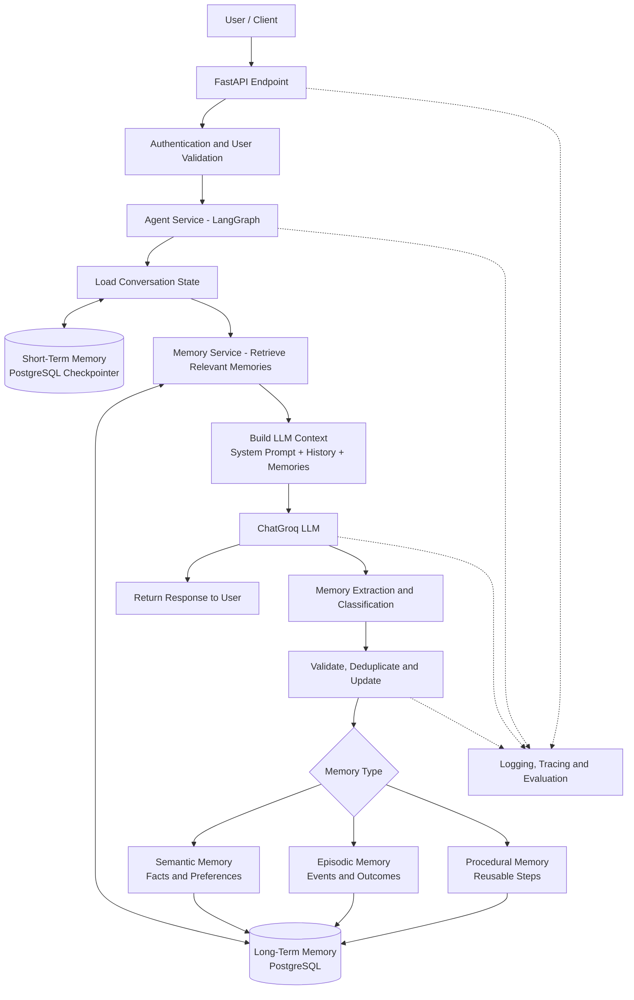

# Production Agentic AI Memory — Workflow

This document describes the workflow for a decoupled Agentic AI application using LangGraph, a separate memory service, and PostgreSQL.

## Workflow diagram

## Workflow overview

1. **Request and identity:** The API authenticates the caller and establishes the authorized user ID and conversation/thread ID.
2. **Conversation state:** LangGraph loads and updates short-term state through a PostgreSQL checkpointer, keyed by thread.
3. **Memory retrieval:** The memory service retrieves relevant long-term memories scoped to the authorized user.
4. **Context assembly:** The agent combines the system prompt, conversation state, and selected memories.
5. **LLM response:** The model generates a response, which the API returns to the user.
6. **Memory extraction:** A memory-extraction step identifies candidate facts, events, and reusable procedures from appropriate conversation/task data.
7. **Validation and persistence:** Validate candidates, remove duplicates, handle updates/conflicts, apply privacy rules, and save accepted memories.
8. **Observability:** Record safe operational logs, traces, errors, and evaluation results without exposing secrets or unnecessary sensitive content.

## Long-term memory types

- **Semantic memory:** Stable facts and preferences.
- **Episodic memory:** Specific events, actions, and outcomes.
- **Procedural memory:** Reusable instructions, workflows, and successful methods.

These are logical memory categories; they can be stored in the same PostgreSQL database using a `memory_type` field and suitable metadata.

## Design notes

- Keep agent orchestration and memory persistence in separate modules.
- Use a durable PostgreSQL checkpointer for short-term conversation state.
- Use a separate repository/service for long-term memory CRUD and retrieval.
- Enforce authorization and user-level data isolation on every memory operation.
- Treat extracted memories as untrusted candidates; validate before storing.
- Add migrations, retries, timeouts, tests, backups, and retention/deletion policies.
- Add vector embeddings and semantic similarity search only when needed; exact metadata filters may be sufficient initially.
- For asynchronous memory extraction, use a reliable queue/job mechanism and track failures so updates are not silently lost.

## Suggested repository location

Save this file as:

`docs/architecture/workflow.md`
